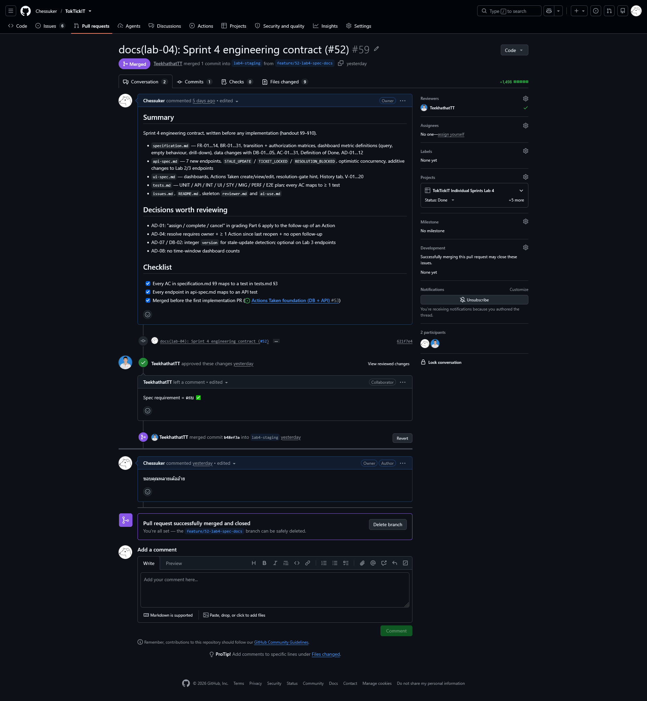

# Answer Part 2 — Spec-Driven Development

Link: [`docs/lab-04/specification.md`](specification.md) — rendered in full after this page, with its companions [`api-spec.md`](api-spec.md), [`ui-spec.md`](ui-spec.md) and [`tests.md`](tests.md).

---

## 1. The contract came first

| When | What | Commit |
| --- | --- | --- |
| 2026-10-03 18:14 | Sprint 4 engineering contract written (specification, API, UI, test plan, issues) | `621f7e4` |
| 2026-10-07 14:37 | Contract **merged** into `lab4-staging` after review ([#59](https://github.com/Chessuker/TokTickIT/pull/59), approved by TeekhathatTT) | `b48ef3a` |
| 2026-10-08 22:49 | First implementation commit (#53 Actions Taken foundation) | `8cd5324` |
| 2026-10-29 14:20 | First implementation PR merged ([#60](https://github.com/Chessuker/TokTickIT/pull/60)) | `213ec64` |

The specification was merged a full day before the first line of implementation and three weeks before the first implementation PR merged. Every later PR cites the rules it implements (BR-, AC-, ui-spec §) in its description, and where implementation taught us something, the contract was changed in the same PR and the change is named there — for example the follow-up assignee (AD-01, decided before code), the `actionAt` lower bound "compared exactly" (BR-05, changed by the #60 review), and `resolutionGate.reopenedAt` (api-spec §2, added in #55).

---

## 2. Where each required element is

| Required by the sheet | specification.md |
| --- | --- |
| Numbered requirements | §4 — FR-01 … FR-14 |
| Business rules | §5 — BR-01 … BR-31 |
| Actions Taken rules | §5 "Actions Taken" — BR-01 … BR-12 (performer from the session, field rules, follow-up lifecycle, append-only, locked on Resolved / Closed / Cancelled, `clientRequestId` replay, stable order) |
| Ticket transition rules | §5 "Ticket workflow" — BR-13 … BR-20 and the transition matrix, with the resolution gate (BR-14) on every move into Resolved |
| Dashboard calculations | §5 "Dashboards" — BR-21 … BR-27 and the metric table: each metric's key, label, calculation and drill-down link |
| Acceptance criteria | §9 — AC-01 … AC-31 (Given / When / Then) |
| Migration decisions | §7 "Migration, backfill and rollback" and "Database design decisions" (DB-01 … DB-05), BR-29 |
| Product Definition of Done | §10.1 |
| Assumptions and decisions | §11 — AD-01 … AD-12, each with its rationale |
