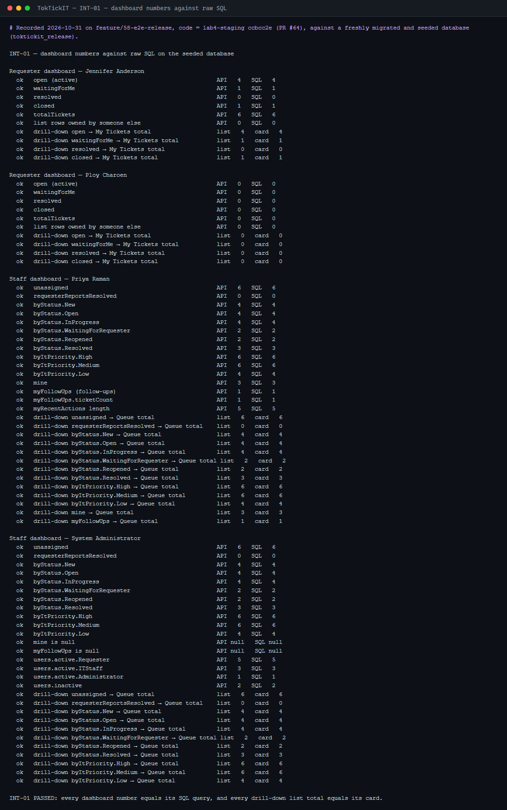
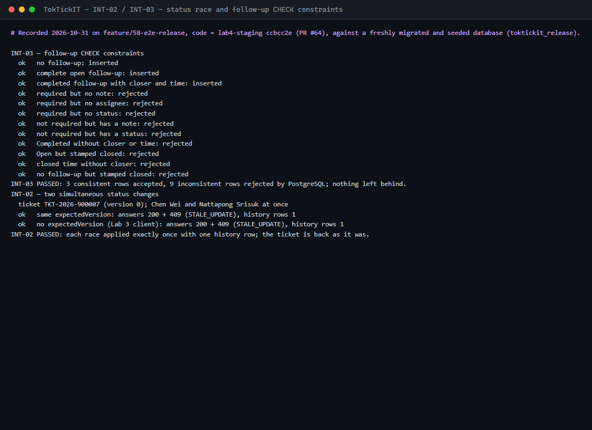

# Answer Part 3 — Test-Driven Development and Traceability

Link: [`docs/lab-04/tests.md`](tests.md) — rendered in full after this page: the planned tests (UNIT, API, INT, UI, STY, MIG, PERF, E2E) with their actual file paths and final status (§2), the acceptance-criterion traceability matrix (§3), the responsive checklist (§4), and the commands, results and per-issue logs (§5).

---

## 1. Regression run on `feature/58-e2e-release` — every suite, nothing skipped

| Suite | Command | Files | Tests | Passed | Failed | Skipped |
| --- | --- | --- | --- | --- | --- | --- |
| Backend — unit, API and authorization | `npm run test:server` | 26 | 926 | 926 | 0 | 0 |
| Frontend — UI component | `npm run test:client` | 19 | 358 | 358 | 0 | 0 |
| End-to-end — Playwright (Lab 2, 3 and 4) | `npx playwright test` | 13 | 134 | 134 | 0 | 0 |
| **Total** | | **58** | **1 418** | **1 418** | **0** | **0** |

These numbers are from the full run on the `feature/58-e2e-release` branch (code = `lab4-staging` after PR #64 plus the #58 fixes), before the release PR. They are **not** a run on `main`: the suites are run again on `main` after the release merge, and this table and the files below are replaced with that run's output.

The verbatim output of each command is in [`test-runs/`](test-runs/) — `server.txt`, `client.txt`, `e2e.txt`, `lint.txt` — with terminal colour codes stripped and nothing else changed; each file's first two lines name the command, the branch and the commit it ran against. The images below are those files rendered by [`scripts/capture-test-runs.mjs`](scripts/capture-test-runs.mjs).


The end-to-end suite runs against the real stack (PostgreSQL migrated and seeded, the API on :5000, Vite on :5173):

```bash
docker compose up -d && npm run prisma:migrate && npm run prisma:seed && npm run test:e2e
```

---

## 2. Coverage by the levels the sheet names

| Level | Where it lives |
| --- | --- |
| **Unit** | `server/tests/lab-04/actionRules.test.ts` (field and follow-up rules, BR-05 boundaries), `resolutionGate.test.ts` (every gate combination, reopen), `dashboardMetrics.test.ts` (every card's `href` re-parsed into its own `where`), `ticketListQuery.test.ts`, `appendOnly.test.ts`; `server/tests/lab-03/ticketWorkflow.test.ts` (every status pair); `client/src/components/lab-04/dates.test.ts` |
| **API / integration** | `server/tests/lab-04/actions-taken.api.test.ts`, `ticket-workflow.api.test.ts`, `requester-dashboard.api.test.ts`, `staff-dashboard.api.test.ts`, `regression.api.test.ts`; against PostgreSQL: INT-01 (dashboards vs SQL), INT-02 (concurrent status race), INT-03 (CHECK constraints), MIG-01 / MIG-02 (migration and rollback) |
| **Authorization** | `server/tests/lab-03/authorization.api.test.ts`; Lab 4 role rows in each Lab 4 API suite (Requester `403` on staff routes and dashboards, Administrator `403` on the workflow, another Requester's Actions and history `403`, no session `401`) |
| **Workflow** | `ticket-workflow.api.test.ts` (matrix through the API, gate, reopen, stale `409`, history rows, Cancel cancels follow-ups), `client/.../lab-04/TicketWorkflow.test.tsx`, `e2e/lab-04/ticket-resolution.spec.ts` |
| **UI** | `client/src/components/lab-04/*.test.tsx` (Actions Taken, workflow, both dashboards, Modal, single submission) and every Lab 2 / Lab 3 component suite |
| **Regression** | Every Lab 2 and Lab 3 server, client and Playwright suite runs unchanged in the same commands (API-36, UI-22, E2E-08); the only edits are listed in tests.md §5 "Documented changes to earlier suites" |
| **E2E** | `e2e/lab-04/actions-taken-flow.spec.ts`, `ticket-resolution.spec.ts`, `dashboards.spec.ts`, `visual.spec.ts` plus the Lab 2 / Lab 3 specs |

---

## 3. Evidence that the tests test something

Each feature PR recorded deliberate mutations — breaking the code on purpose and confirming a test fails — in tests.md §5. Examples: dropping the version check from the conditional write (20 tests fail), skipping the resolution gate (4), widening "My open tickets" past the session user (6), disabling the single-submit guard (13). Two real defects were found this way: a duplicate-submit gap that a double click could not reveal (#54) and five Lab 2/3 forms that sent twice on a same-tick submit (#57).

---

## 4. Database checks (fresh, seeded database)

INT-01, INT-02 / INT-03 and PERF-01 need PostgreSQL and were run on a newly created, migrated and seeded database, so their numbers are the seed's and nothing else:




