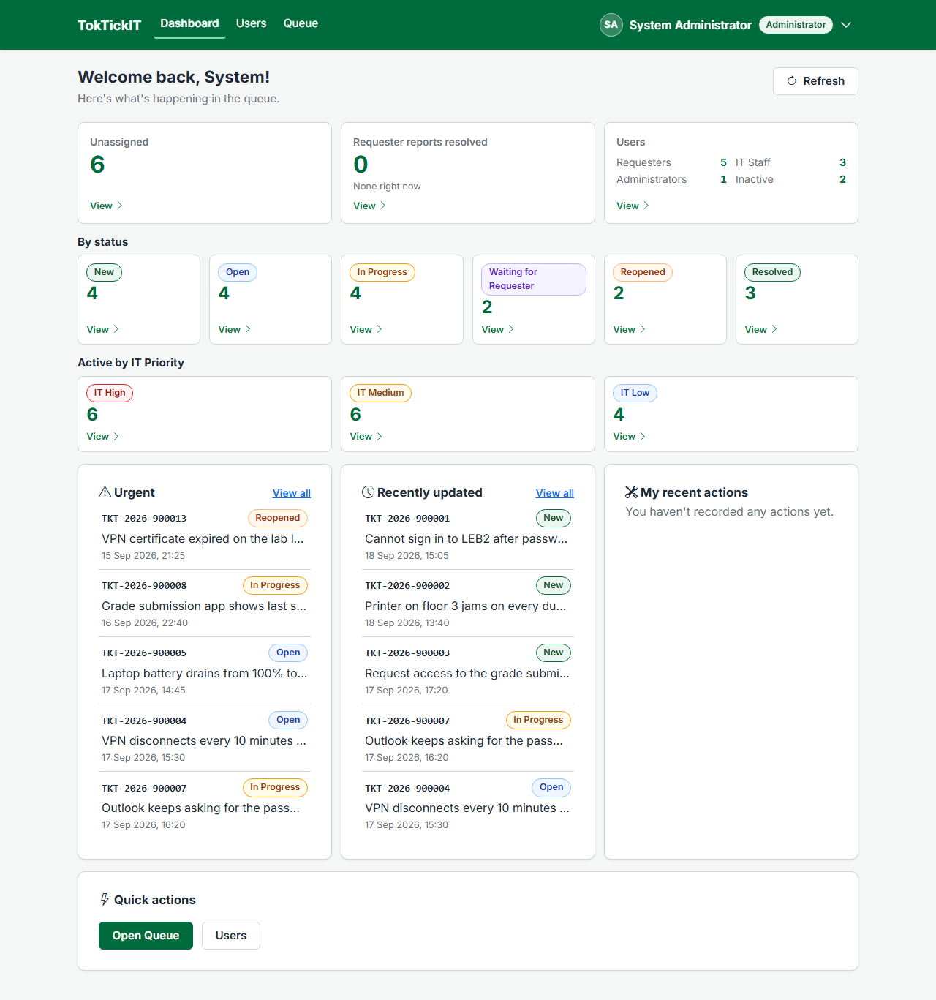
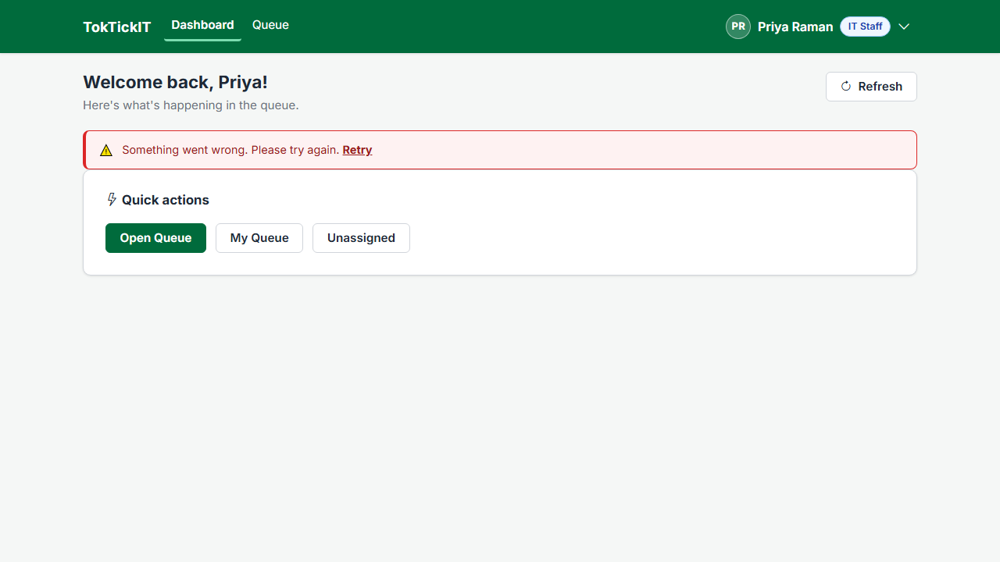
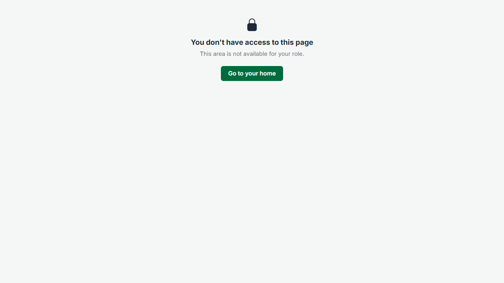

# Answer Part 5 — Working IT Staff Dashboard UI

Screens: `/dashboard` as IT Staff (Priya Raman) and as the Administrator. Every image below was captured by `CAPTURE=1 npx playwright test e2e/lab-04` on a freshly migrated and seeded database. Contract: specification.md §5 "Dashboards" (BR-21 … BR-27 and the metric table), api-spec.md §3.7, ui-spec.md §1.3, §1.4, §3.2.

---

## 1. Approved metrics, the current user's Actions Taken, urgent and recent Tickets

| Area | What it shows | Definition |
| --- | --- | --- |
| Primary cards | Unassigned · My open tickets · My open follow-ups ("across N tickets") · Requester reports resolved | Active statuses only (New, Open, In Progress, Waiting, Reopened — BR-22); "my" = owner / follow-up assignee is the session user (BR-24) |
| By status | New · Open · In Progress · Waiting · Reopened · Resolved, each labelled with its status badge | One count per status |
| Active by IT Priority | IT High · IT Medium · IT Low | Active Tickets per IT Priority |
| Urgent | Active, IT High, longest untouched first, 5 rows | BR-25 |
| Recently updated | Any status, newest first, 5 rows | BR-25 |
| **My recent actions** | The caller's own Actions Taken: ticket, description preview, time, follow-up badge — each opens the Ticket on its Actions Taken tab | `performedById` = session user, newest first, 5 |

Every number is computed by the server on each request, in one `REPEATABLE READ` read so all cards describe the same moment (BR-21), and every card is one link whose accessible name says label and value, for example "My open follow-ups: 1 follow-up across 1 ticket".

The Administrator gets the same dashboard without the two "my" cards (they never own Tickets or follow-ups, BR-24) and with user-account counts instead:

---

## 2. Accurate counts — checked against the database (INT-01)

[`server/scripts/verify-lab04-dashboards.ts`](../../server/scripts/verify-lab04-dashboards.ts) calls both dashboards through the real routes as Jennifer, Ploy, Priya and the Administrator, and compares **every** number with a hand-written SQL query that shares no code with the API. It then follows every card's link into its list and checks the list's total equals the card. Run on a freshly migrated and seeded database: **76 checks, 0 failures**.

Verbatim output: [`test-runs/int-01-dashboards.txt`](test-runs/int-01-dashboards.txt). The same checks run without a database in API-29 … API-33 (an in-memory fake that evaluates every `where`), and UNIT-05 proves each card's link parses back into exactly the filter it counts with.

---

## 3. Drill-down

Each card opens the Queue already filtered, with the same total as the card (BR-27, AC-20). "My open follow-ups" counts follow-ups and opens the Tickets that hold them, shown as a removable chip:

E2E-05 follows every card for IT Staff and the Administrator and compares each list total with its card.

---

## 4. Loading, empty, forbidden and safe failure

| State | Evidence |
| --- | --- |
| Loading | Labels stay, values are skeletons, quick actions usable (shared component; UI-15 / UI-18, `requester-dashboard/loading.png`) |
| Empty | Zero shows "0" and "None right now"; an empty list shows its own line — the Administrator's "My recent actions": "You haven't recorded any actions yet." (above); UI-18 renders an all-zero dashboard |
| Forbidden | A Requester opening a staff URL gets the Forbidden state; the API answers `403` with no numbers (API-32, E2E-06) |
| Safe failure | "Something went wrong. Please try again." with **Retry**, quick actions still usable |

---

## 5. Responsive

| 820 px | 375 px |
| --- | --- |
|  |  |

Primary cards go 4 → 2 × 2 → 2 per row, the three lists stack below 992 px, and the page never scrolls sideways (STY-01). PERF-01 on the same database: p95 under 30 ms, response 5.1 KB ([`test-runs/perf-01-smoke.txt`](test-runs/perf-01-smoke.txt)).
