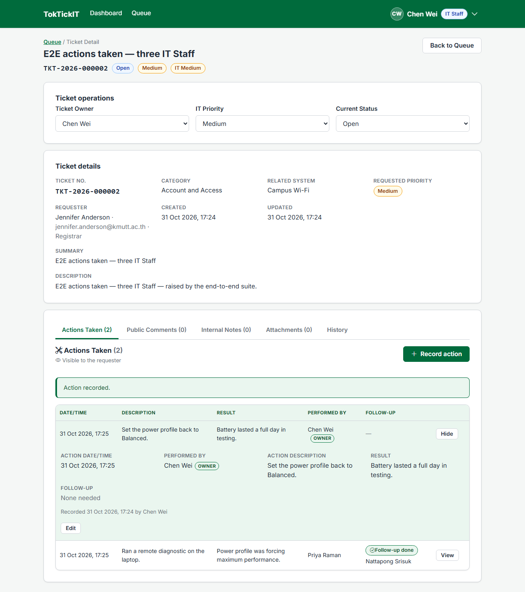
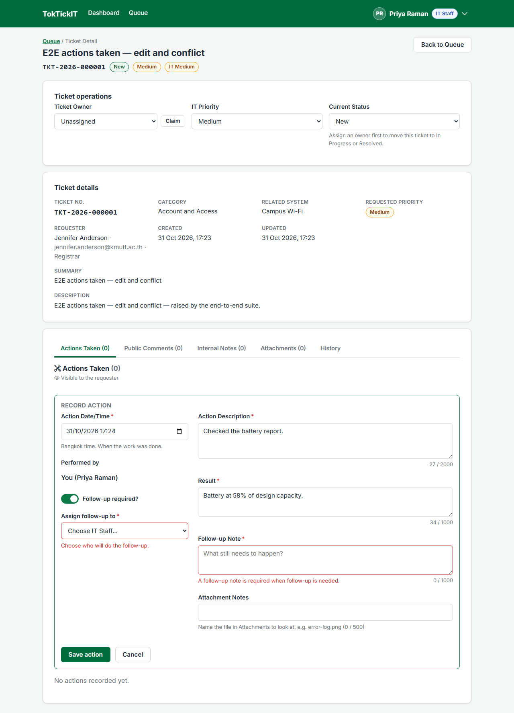
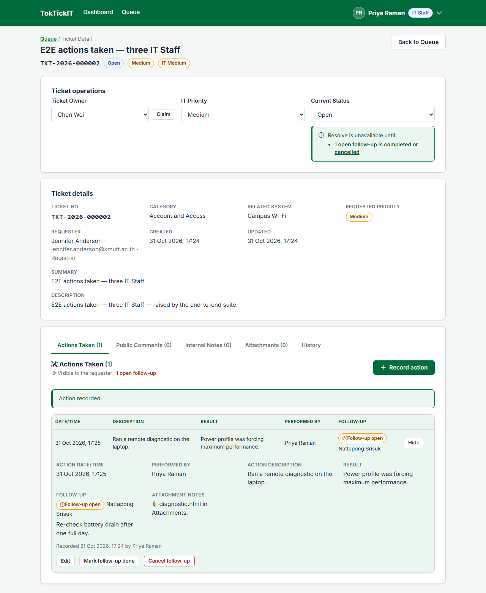
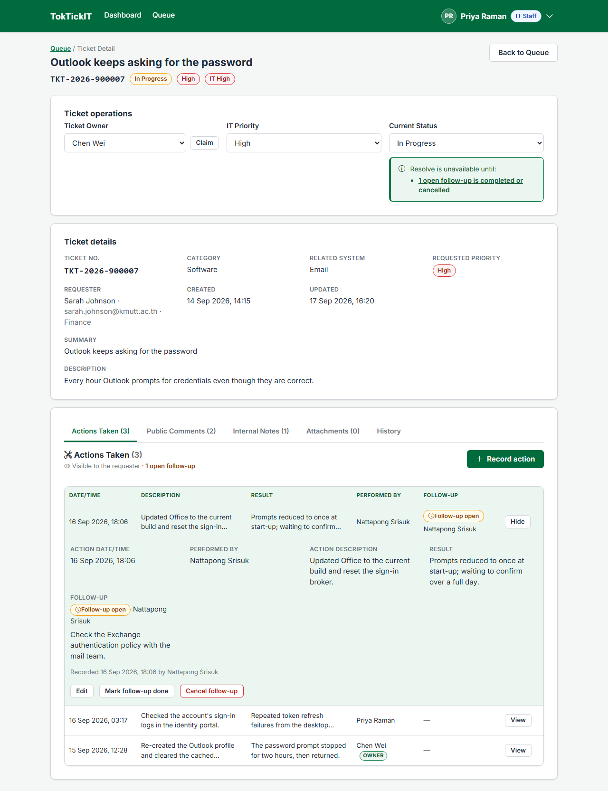
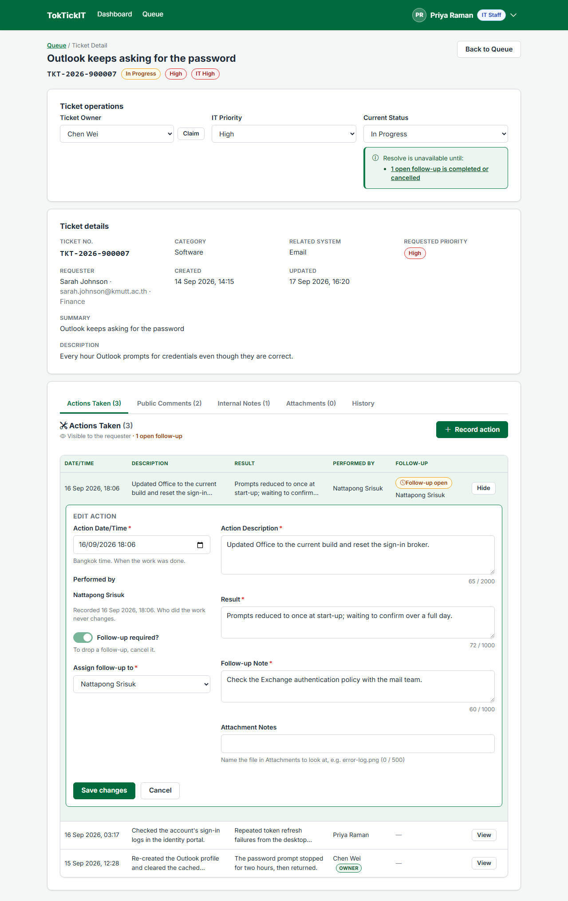
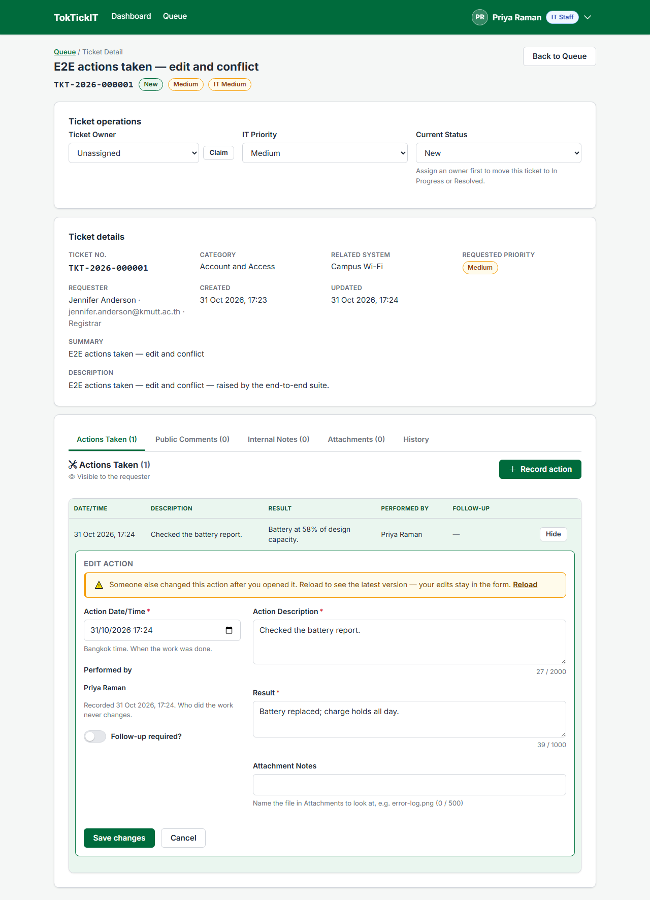
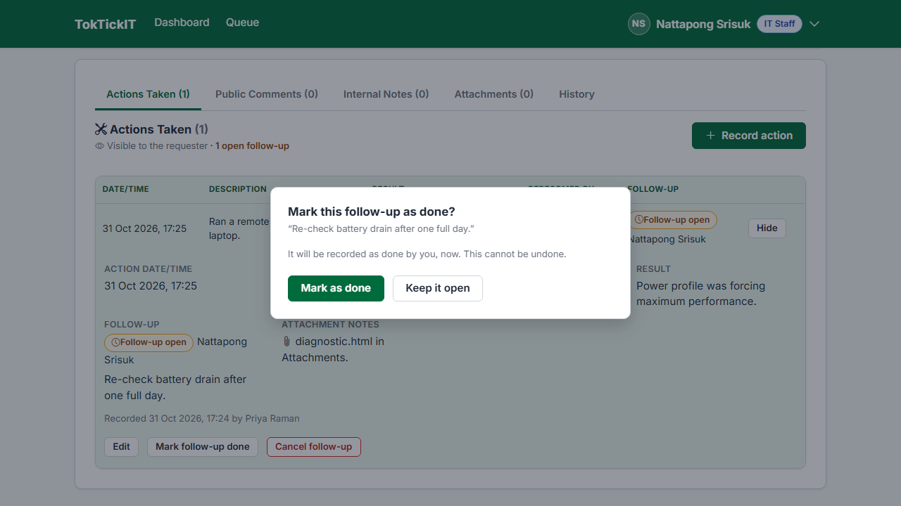
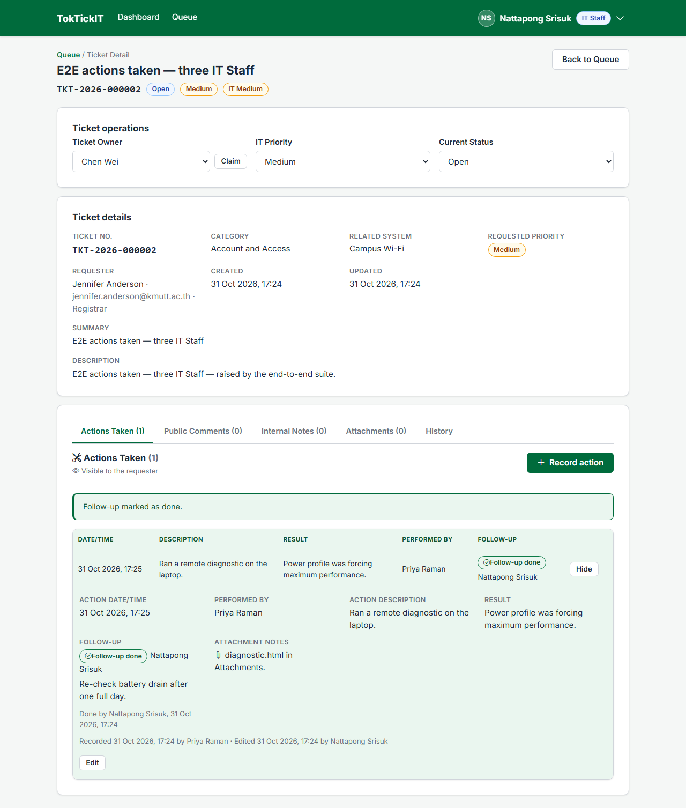
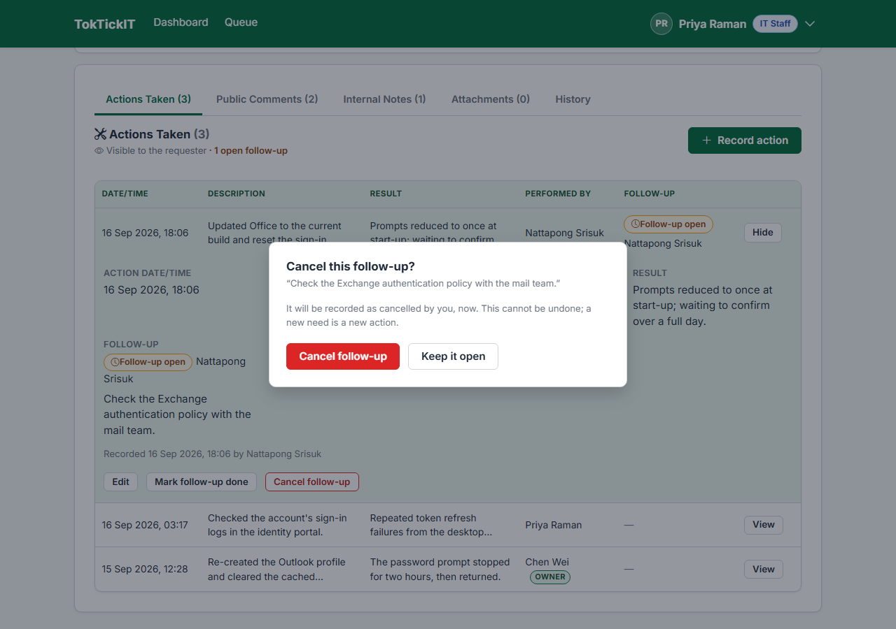

# Answer Part 6 — Working Actions Taken UI

Screen: the **Actions Taken** tab, first and default on the Staff Ticket Detail, and "Work done by IT" on the Requester's Ticket Detail. Images captured by `CAPTURE=1 npx playwright test e2e/lab-04` on a freshly migrated and seeded database. Contract: specification.md BR-01 … BR-12, AD-01 (the follow-up carries the assignee and the Open → Completed / Cancelled status), api-spec.md §3.1 – §3.4, ui-spec.md §3.3, §3.6.

---

## 1. List — different Actions Taken on one Ticket

`TKT-2026-900007`, owned by Chen Wei, has three Actions by three IT Staff members; each keeps its own **Performed by**, the owner's carries an "Owner" tag, and the order is stable (date/time newest first, BR-11):


A Ticket worked by several people end to end (E2E-02): Priya records with a follow-up for Nattapong, Nattapong completes it, Chen (the owner) records the second Action:



---

## 2. Create, with validation

Required fields are checked under each field before anything is sent; the server repeats every rule and its `fields` errors land under the same fields; the typed values stay.



---

## 3. Assign (follow-up) and inactive-assignee rejection

Switching **Follow-up required** on reveals a required note and an assignee select that lists active IT Staff only, the owner preselected:



An inactive IT Staff member can never be chosen, and the server refuses one sent directly (BR-06):

```text
POST /api/staff/tickets/<ticket>/actions   { "followUpRequired": true, "followUpAssigneeId": "<Robert Wilson, inactive>", … }
HTTP 400  { "error": { "code": "VALIDATION_FAILED",
                       "fields": { "followUpAssigneeId": "The follow-up must be assigned to an active IT Staff member." } } }
```

Verbatim: [`test-runs/inactive-assignee-refused.txt`](test-runs/inactive-assignee-refused.txt) (E2E-02).

---

## 4. View and edit

View mode shows every field, who recorded it and who last edited it. Edit keeps Performed by and the created time read-only and sends the `version` it was based on:

| View | Edit |
| --- | --- |
|  |  |

An edit based on an old copy is refused with `409 STALE_UPDATE`; the typed text stays and **Reload** brings the latest version to save on top of (E2E-01):



---

## 5. Status transition — complete and cancel

A follow-up moves only Open → Completed or Open → Cancelled, behind a confirmation; the closer and time are stamped and a closed follow-up is final (BR-07):

| Mark as done | Done | Cancel |
| --- | --- | --- |
|  |  |  |

---

## 6. Role restrictions

- **Requester** — the same entries, read-only, with no control of any kind; another Requester's Ticket is `403` (UI-06, API-02):

  

- **Administrator** — may record and edit Actions (AD-02), still read-only for status, owner and IT Priority (API-22).
- **Locked Ticket** — on Resolved, Closed or Cancelled there is no Record or Edit control, only "Reopen it to record more work", and the server answers `409 TICKET_LOCKED` (UI-07, API-10, E2E-01).

---

## 7. Safe failures

A network failure keeps every typed value and offers to try again, with the same `clientRequestId`, so a retry can never create a second Action (UI-03, UI-08, BR-10). A `403` reads "Access denied" and a `404` "Not found" — never "could not reach the server" (UI-08). A same-tick double click sends one request (UI-03, `SingleSubmit.test.tsx`).

---

## 8. Responsive

| 820 px | 375 px |
| --- | --- |
|  |  |

Below 992 px the table becomes cards showing every field; on a phone the form's buttons stay in a sticky bar that the header never covers (V-14).
