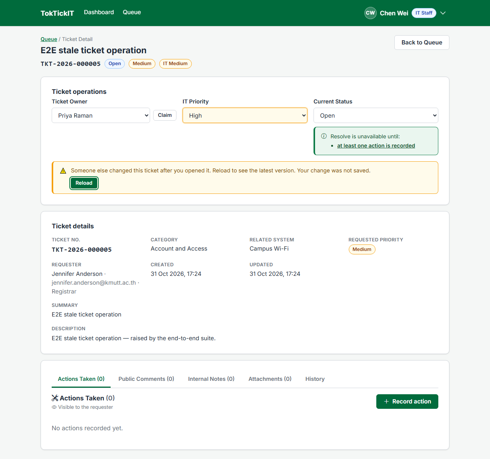
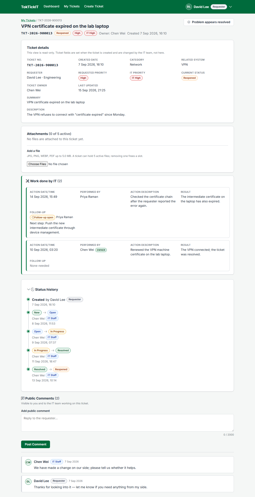

# Answer Part 7 — Working Ticket Workflow

Screens: the operations card and the History tab on the Staff Ticket Detail, and "Status history" on the Requester's Ticket Detail. Images captured on a freshly migrated and seeded database. Contract: specification.md BR-13 … BR-20 and the transition matrix, api-spec.md §3.5, §4.1, §4.2, ui-spec.md §3.4, §3.5.

---

## 1. Permitted transitions only

The status select lists the current status plus `permittedTransitions` from the server, which is computed from the same table that enforces the change, so the UI never restates the matrix. **Resolved** is offered only when the resolution gate is open: an owner, at least one Action since the last reopen, and no open follow-up (BR-14). When it is closed, the screen says which condition is missing, each a link to where it is fixed:

The server is the real guard: a direct `PATCH … /status { "status": "Resolved" }` answers `409 RESOLUTION_BLOCKED` with the unmet conditions; a pair outside the matrix answers `409 INVALID_TRANSITION`; an Administrator or Requester gets `403` (API-14 … API-17, API-21, API-22). Cancelling a Ticket cancels its open follow-ups in the same transaction, and the dialog says how many (BR-16):

Two people acting on the same Ticket cannot overwrite each other: every operation sends the version it was based on, and an old copy gets `409 STALE_UPDATE`, keeps the user's choice highlighted and offers **Reload** (BR-19, E2E-04). INT-02 sends two status changes at the same moment through the real route on PostgreSQL: exactly one applies.

---

## 2. Stable ordering and append-only history

Every status change, including the automatic New → Open on claim, writes one history row in the same transaction; the History tab lists them oldest first after a "Created" row drawn from the Ticket itself:

There is no route that updates or deletes a history row or an Action, and a unit test reads `server/src/**` to prove no code calls one (UNIT-09). Actions are listed in a fixed order (date/time, then creation, then id — BR-11) that an edit never changes unless the date/time does.

---

## 3. Role-appropriate visibility

| Who | Status, owner, IT Priority | Actions Taken | History |
| --- | --- | --- | --- |
| IT Staff | change (permitted targets only) | record, edit, close follow-ups | read |
| Administrator | read-only | record, edit (AD-02) | read |
| Requester (own Ticket) | read; can say "appears resolved", which never changes status (BR-15) | read-only | read, collapsed by default |
| Another Requester | `403` | `403` | `403` |

The full journey — blocked, work recorded, follow-up done, Resolved, Closed, Reopened, blocked again until new work, Resolved — runs end to end in E2E-03 (`e2e/lab-04/ticket-resolution.spec.ts`).

---

## 4. Responsive

| 820 px | 375 px |
| --- | --- |
|  |  |
