# Answer Part 8 — Working Requester Dashboard and Final Regression UI

Screen: `/dashboard` as a Requester (Jennifer Anderson; Ploy Charoen, who has no Tickets). Images captured on a freshly migrated and seeded database. Contract: specification.md BR-21 … BR-27, api-spec.md §3.6, §4.4, ui-spec.md §3.1, §3.7.

---

## 1. Requester-owned metrics, attention-required and recent Tickets

Four counts of the Requester's own Tickets — open (active statuses), waiting for you, resolved, closed — and three five-row lists: **Needs your reply** (waiting for the Requester), **Recently updated**, **Recently resolved**. "Waiting for you" above 0 gets a border and "Reply needed", so it stands out without relying on colour. Every row opens the Ticket.

A Requester with no Tickets sees one panel with the way in:

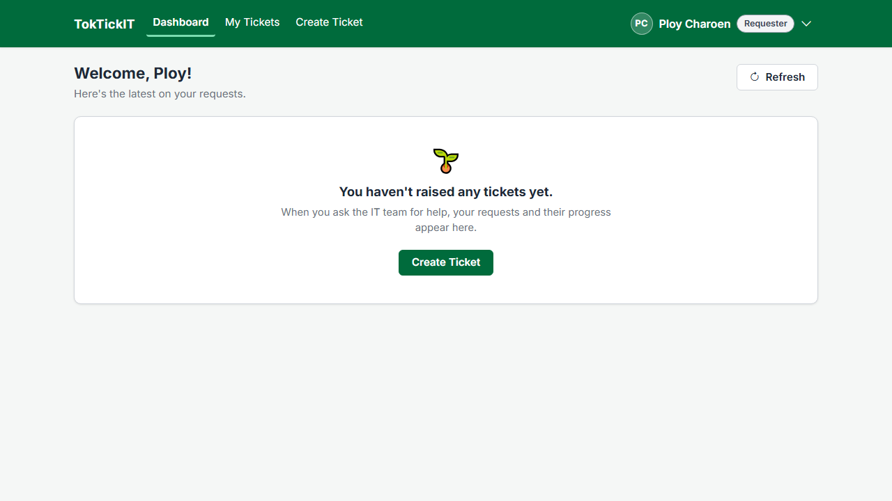

Loading shows skeleton values under the real labels; a failure shows Retry with the quick actions still usable:

| Loading | Safe failure |
| --- | --- |
| 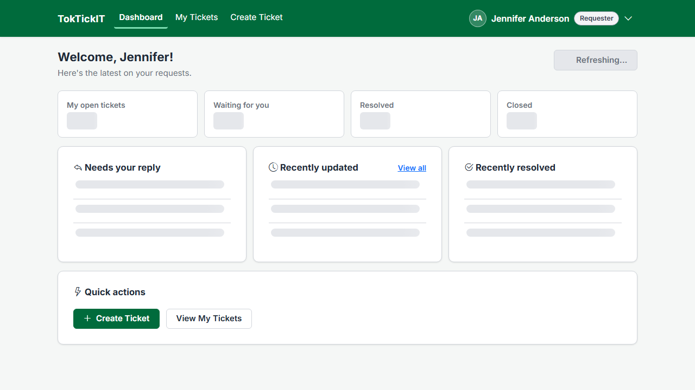 | 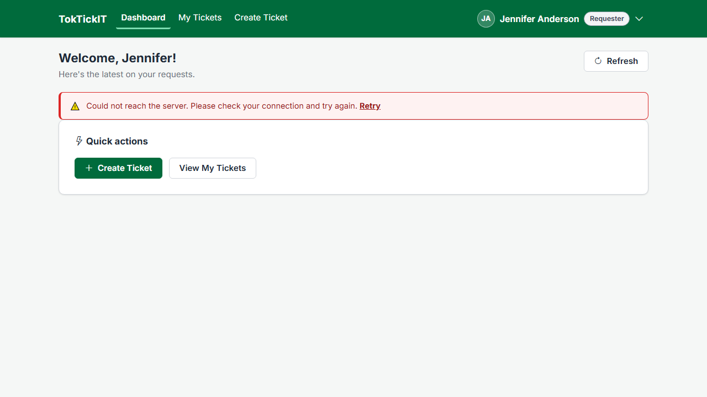 |

---

## 2. Drill-down

Each card opens My Tickets with the same filter, now held in the URL, and the same total. "My open tickets" means five statuses at once, shown as selected chips:

---

## 3. Ownership protection

- The endpoint reads no parameter at all: the Requester is the session user, so `?requesterId=<someone else>` changes nothing (API-24 sends it and compares the answers).
- Every count and list query carries `requesterId = session user` (API-24 inspects each one).
- IT Staff and Administrators calling the Requester dashboard get `403`; no session gets `401` (API-27).
- On PostgreSQL, INT-01 checks that no list row belongs to anyone else ("list rows owned by someone else: 0") and that Ploy's counts are all zero.

---

## 4. Regression — the Lab 2 and Lab 3 features on the Lab 4 build

Every Lab 2 and Lab 3 suite runs unchanged in the final run (Part 3): authentication, My Tickets, Ticket Detail, attachments, Public Comments, the Queue, ticket operations, Internal Notes and user management. The screens, re-captured on the Lab 4 build (R-15):

| Feature | Screen |
| --- | --- |
| Authentication | 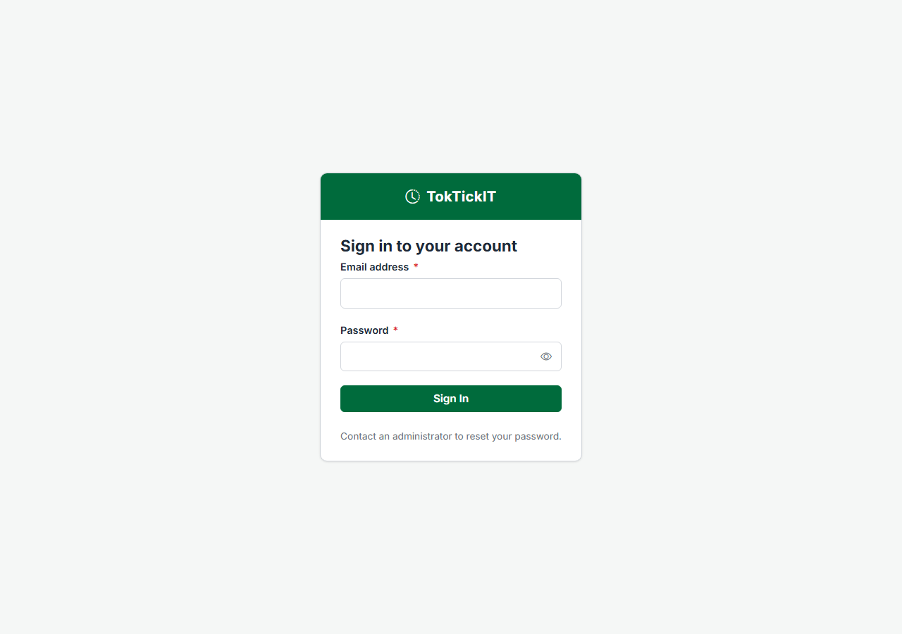 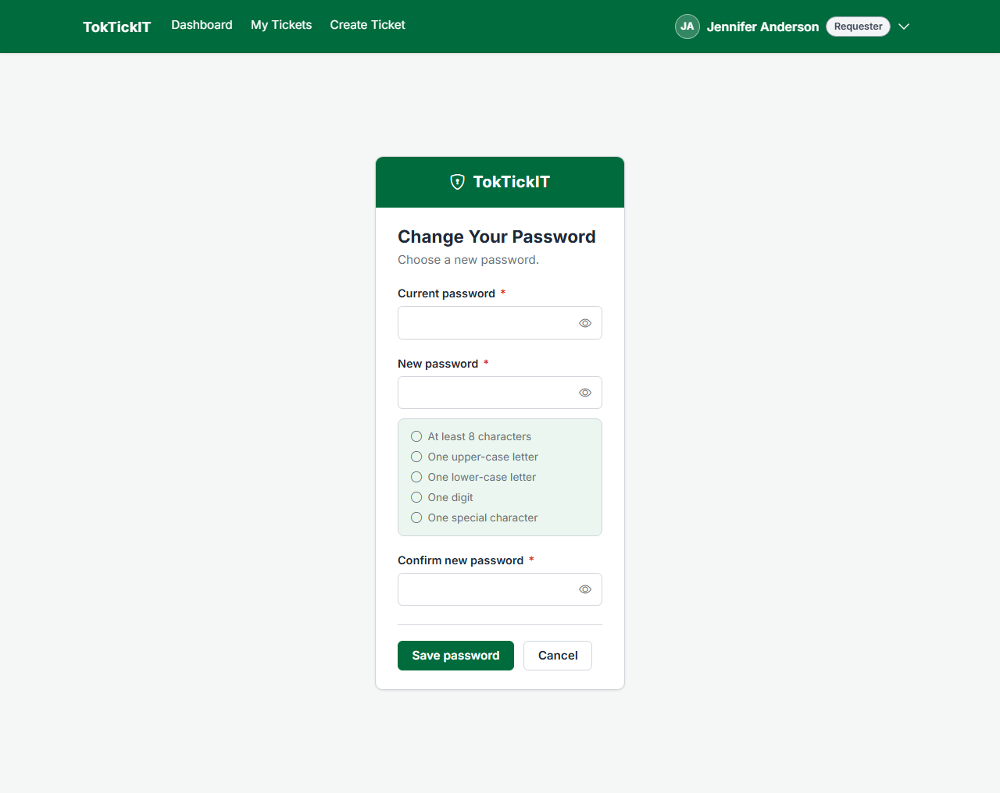 |
| My Tickets | 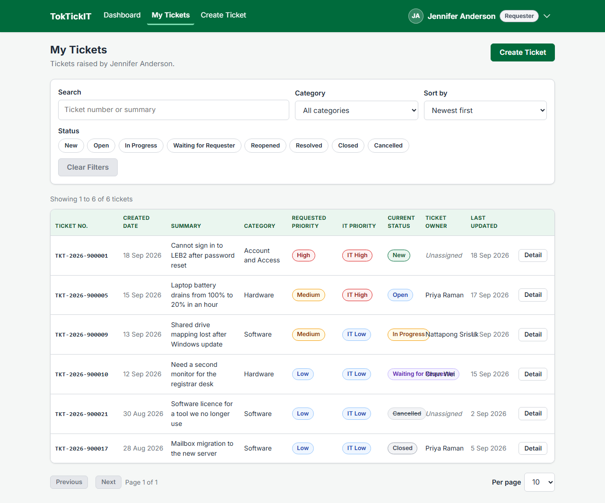 |
| Ticket Detail, Attachments, Public Comments | 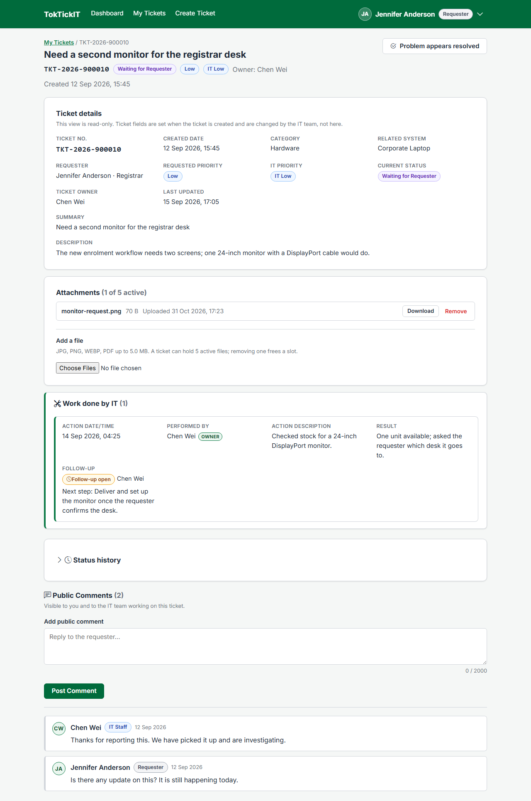 |
| Create Ticket | 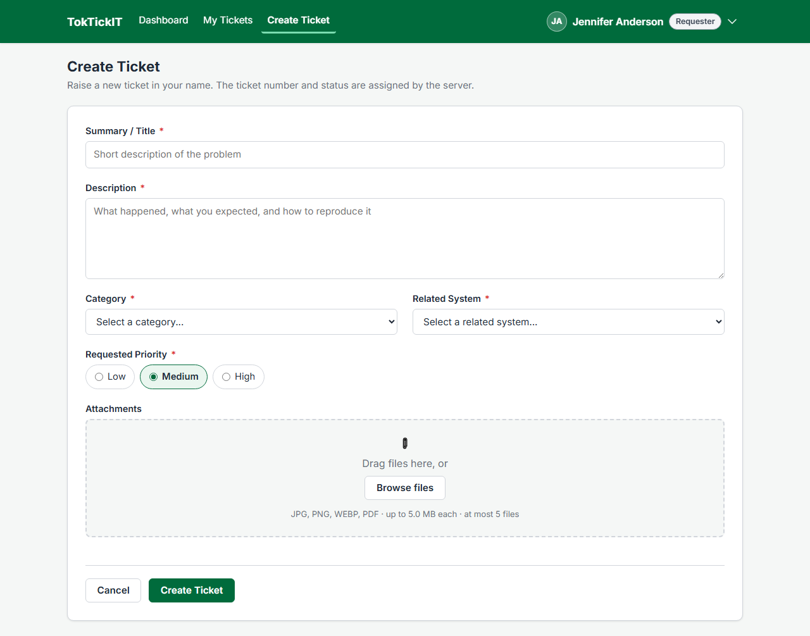 |
| IT Staff Queue | 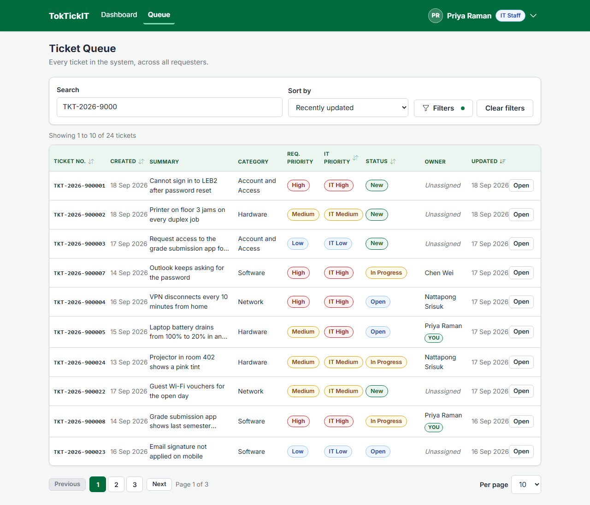 |
| IT Staff Ticket Detail | 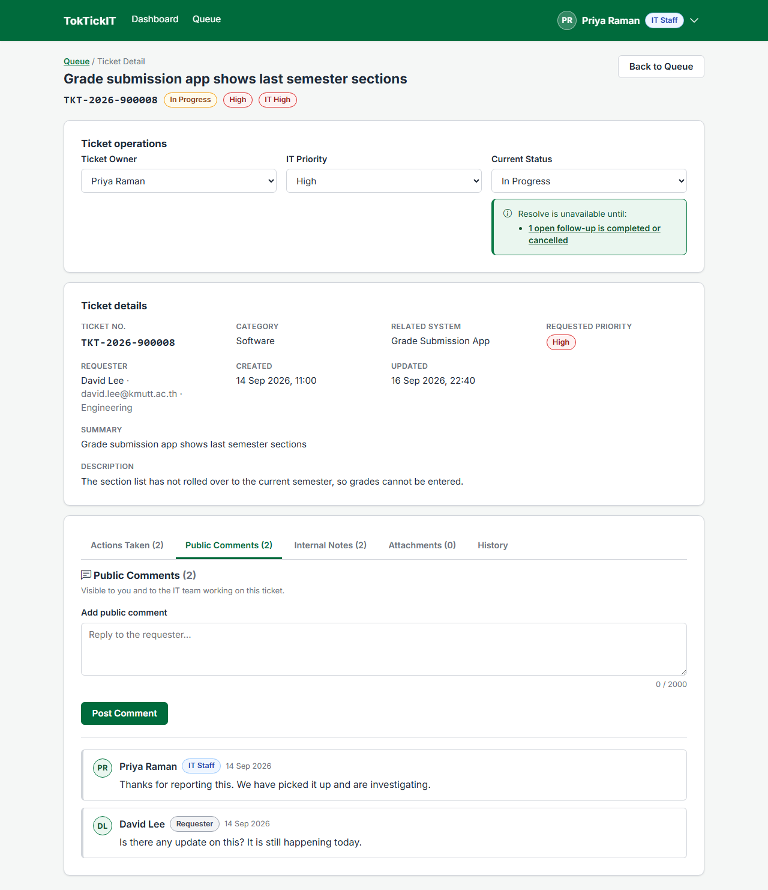 |
| Internal Notes | 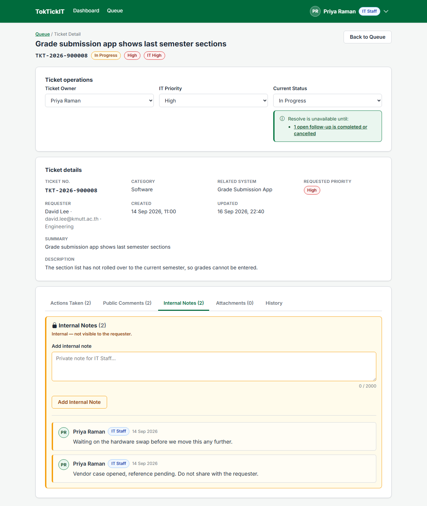 |
| Administrator user management | 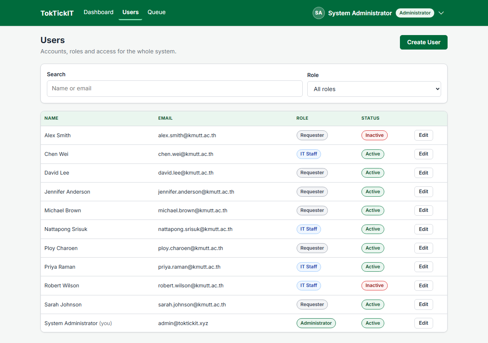 |

The tablet and mobile captures of each are in [`artifacts/lab-04/screenshots/regression/`](../../artifacts/lab-04/screenshots/regression/).

What changed for these screens in Lab 4, on purpose: every role lands on the Dashboard; My Tickets keeps its filters in the URL with status chips; every date is shown in Bangkok time; every form sends once on a double submit; every dialog keeps keyboard focus inside. The earlier tests that had to follow these changes are listed in tests.md §5.
